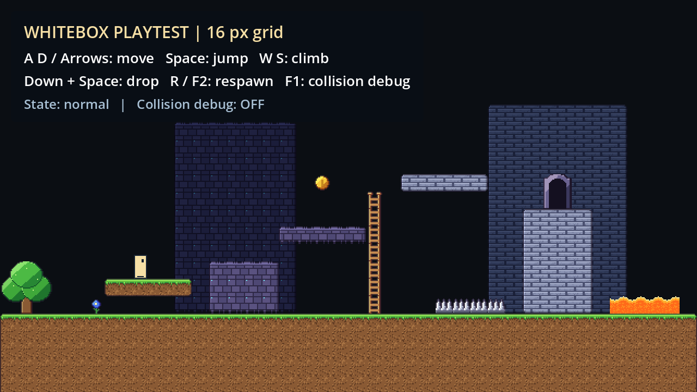

# Godot Level Greybox Test

用 **Godot** 搭建 2D 解谜游戏的白盒关卡，把脑子里的路线、空间和谜题流程变成能看、能走、能测试的关卡示意。

目标很朴素：**造福我这种“垃圾策划”——少画几张只有自己看得懂的草图，多做几个能实际跑起来的关卡。**

## 这个项目拿来干什么

- 快速摆出房间、平台、通道、梯子和危险区，说明关卡的空间结构。
- 标记门、钥匙、开关、收集物和机关的位置，讨论解谜流程与探索路线。
- 用测试角色检查跳跃距离、落差、平台穿透和攀爬，尽早发现“纸上能过，实际过不去”。
- 先验证关卡思路，再逐步补充正式美术、机关逻辑和游戏内容。

项目的主要用途是**关卡设计示意与玩法验证**。目前提供白盒搭建环境和基础移动测试，解谜机关可以按自己的设计继续扩展。

## 已经准备好的东西

- 16×16 像素网格，387 个原生素材和额外 8 个动画瓦片；大树、门等多格物件可完整摆放。
- 9 套分类瓦片集和 9 个绘制图层，分开管理背景、地形、平台、装饰、攀爬、液体、危险物和交互标记。
- 12 套地形连接规则，以及可直接盖出的地块、平台图案。
- 地形碰撞、单向平台、攀爬、危险区重生和液体减速测试。
- 一个空白关卡模板、一个演示关卡和一个素材分类陈列场景。
- 已启用 Godot AI MCP 插件，方便在本机连接配置完成后辅助编辑项目。

## 开始摆关卡

1. 使用 **Godot 4.7.2** 导入仓库根目录的 `project.godot`。
2. 打开 `scenes/levels/whitebox_template.tscn`，另存为自己的关卡。
3. 在场景树中选中对应的 `TileMapLayer`，通过底部 **TileMap** 面板绘制瓦片；地形可使用 **Terrains / 地形**，预设地块可使用 **Patterns / 图案**。
4. 调整 `Spawn` 出生点和 `Camera2D` 的位置，按 **F6** 测试当前关卡。

按 **F5** 可以运行演示关卡。更详细的分层、碰撞和编辑说明见 [开始摆关卡](README_开始摆关卡.md)。

## 测试操作

| 操作 | 按键 |
| --- | --- |
| 左右移动 | A / D 或方向键 |
| 跳跃 | 空格 |
| 攀爬 | W / S 或上下键 |
| 穿过单向平台 | 下 + 空格 |
| 回出生点 | R / F2 |
| 显示碰撞 | F1 |

## 目录

| 路径 | 内容 |
| --- | --- |
| `scenes/levels/` | 空白模板与演示关卡 |
| `scenes/reference/` | 素材分类陈列 |
| `tilesets/` | 分类瓦片集与总集 |
| `assets/` | 原生素材、分类图集与素材许可 |
| `scripts/` | 测试角色与关卡辅助脚本 |
| `tools/` | 素材整理、瓦片生成和验证工具 |
| `docs/` | 审计、验证记录和示意截图 |

## 当前范围

门、开关、钥匙、弹簧、检查点和移动平台素材目前主要作为关卡标记或静止平台，没有预设完整的开门、收集、机关联动与移动轨迹。液体目前统一用于减速测试。

原始地形素材缺少部分内凹角和狭窄连接组合，复杂边角需要手动选瓦片。日常摆关卡不必运行生成器；重新生成会重置生成的模板、演示和瓦片集，自己的关卡请另存。

## 素材许可

像素素材来自 **reodesuxz** 的 Pixel Forest Platformer Tileset、Pixel Platformer Tileset Vol. 2 和 Vol. 3，原始许可随项目保留：

- [Forest 素材许可](assets/tiles/forest/source/LICENSE.txt)
- [Vol. 2 素材许可](assets/tiles/vol2/source/LICENSE.txt)
- [Vol. 3 素材许可](assets/tiles/vol3/source/LICENSE.txt)

这些素材允许用于个人及商业项目；请遵守原许可，不要将素材提取后作为独立素材包或素材库再分发。Godot AI 插件采用其随附的 [MIT 许可](addons/godot_ai/LICENSE)。
